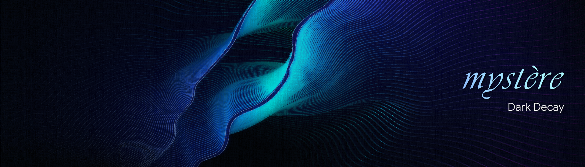

Mystere is a mostly experimental, one-to-one private messenger. This repository contains a browser client, a relay, and a separate custodian service. The relay carries encrypted messages; the custodian holds an encrypted fragment of each message key. The recipient needs the sender's fragment, their own fragment, and a device-verified custodian release to open a message.

Dark Decay (Beta) is a working browser prototype, not an independently audited or production-ready messenger. Identities and active conversations live in browser memory. Closing or refreshing a tab loses that tab's identity and access to its conversation.

# How to use it?

## Requirements

- Python and Node.js, with a connection to install dependencies on a fresh checkout.
- A browser with WebCrypto, Ed25519, and WebAuthn support.
- A working device authenticator for WebAuthn user verification. The prompt may use a PIN or biometric, depending on the device.
- Three free local ports: 8000 for the relay, 8001 for the custodian, and 5173 for the client.

The commands below are for Windows PowerShell and run from the repository root. Use **http://localhost:5173** exactly: the custodian's default WebAuthn origin is tied to that address. You do not need Docker for this local test.

## Installation

~~~powershell
py -m venv .venv
.\.venv\Scripts\python.exe -m pip install -r relay\requirements.txt -r custodian\requirements.txt
cd client
npm.cmd ci
cd ..
~~~

PowerShell may block npm.ps1. Calling npm.cmd avoids changing your execution policy. If the Python packages and client/node_modules are already installed, you can skip the corresponding install commands. A fresh install still needs access to the package registries.

## Start the local services

Open three PowerShell windows in the repository root. Keep them open during the test. The SQLite files below are for local development; they are stored in your Windows temporary directory.

**Window 1 - relay**

~~~powershell
$relayDb = (Join-Path $env:TEMP 'mystere-relay-local.db').Replace('\','/')
$env:RELAY_DATABASE_URL = "sqlite:///$relayDb"
.\.venv\Scripts\python.exe -m relay.app.init_db
.\.venv\Scripts\python.exe -m uvicorn relay.app.main:app --host 127.0.0.1 --port 8000
~~~

**Window 2 - custodian**

~~~powershell
$custodianDb = (Join-Path $env:TEMP 'mystere-custodian-local.db').Replace('\','/')
$env:CUSTODIAN_DATABASE_URL = "sqlite:///$custodianDb"
.\.venv\Scripts\python.exe -m custodian.app.init_db
.\.venv\Scripts\python.exe -m uvicorn custodian.app.main:app --host 127.0.0.1 --port 8001
~~~

**Window 3 - browser client**

~~~powershell
cd client
npm.cmd run dev -- --host localhost --port 5173 --strictPort
~~~

Open **http://localhost:5173** in your browser. Stop each service with Ctrl+C. Running the database initialization commands again is safe; they create missing tables without deleting existing ones.

## Try a conversation

1. In the first tab, click **Register & Connect**. Copy its Mystere ID and identity fingerprint.
2. Click **Enroll device verification** and complete the WebAuthn prompt.
3. Open the same URL in a second tab. Register and enroll there too; it gets a different ID and fingerprint.
4. In the first tab, enter the second tab's ID and fingerprint, then click **Request session**.
5. In the second tab, compare the first tab's fingerprint, enter it under **Expected sender fingerprint**, and click **Accept verified peer**.
6. Wait for **Peer device ready** in both tabs. Send a message in one tab. In the receiving tab, click **Verify and open** and complete its device prompt.

Keep both tabs open until the recipient opens the message. The sender holds one key fragment only in memory. Refreshing a tab creates a new identity; it does not restore the old conversation.

If enrollment fails, check that you opened localhost rather than 127.0.0.1 and that the browser can use a device authenticator. If **Request session** is disabled, finish device enrollment and check that the relay is running. A connection or custodian error usually means the service on port 8000 or 8001 is not running.

## Run the automated checks

From the repository root:

~~~powershell
.\.venv\Scripts\python.exe -m pytest -q tests\relay tests\custodian
node --test tests\baseline_crypto.test.mjs
cd client
npm.cmd test -- --run
npm.cmd run build
~~~

These checks cover important protocol behavior, including signatures, prekeys, message shares, WebAuthn challenge handling, rotation, and decoy framing. The actual device prompt still needs a browser and authenticator test. Passing tests are not a security audit.

# Why I made this

There is no need to know, but it is a collaborative effort between vt and vnr. that is it

# Technical Stack

## Components

| Component | Current implementation | Responsibility |
| --- | --- | --- |
| Browser client | React 18, Vite, WebCrypto, and @privacyresearch/libsignal-protocol-typescript | Creates temporary identities, verifies peers, encrypts messages, and holds active key material in memory. |
| Relay | FastAPI, SQLAlchemy, WebSockets, and PostgreSQL for the intended server setup | Registers signed identities and prekeys, records session commitments, and queues encrypted envelopes. |
| Custodian | FastAPI, SQLAlchemy, and Python WebAuthn verification | Stores an encrypted share blob under an opaque storage key, verifies device assertions, and signs release receipts. |
| Local test storage | SQLite | Lets the three services run without Docker. It does not provide PostgreSQL's concurrency behavior. |

The development Compose file starts two PostgreSQL databases only; it does not start the relay, custodian, or browser client. Redis is not used by the current services. Environment variables such as RELAY_DATABASE_URL, CUSTODIAN_DATABASE_URL, CUSTODIAN_WEB_ORIGIN, and the VITE service URLs are listed in .env.example. That file is an example, not an automatically loaded configuration file.

## How a message opens

1. Both peers register signing and Signal keys, compare identity fingerprints, and complete a signed session request and acknowledgement.
2. The sender creates a fresh AES-GCM message key. A 3-of-3 XOR split turns it into three shares; all three are required to reconstruct the key.
3. The sender keeps one share in memory. Signal protects the share and per-message capability sent to the recipient. The custodian receives only an encrypted third share, its opaque storage key, and the recipient's enrolled credential ID.
4. The recipient requests the custodian share with a fresh WebAuthn assertion. The custodian checks the challenge, origin, relying-party ID, and user-verification flag before returning the encrypted blob and a signed release receipt.
5. After verifying that receipt, the sender releases its share through the encrypted channel. The recipient combines the three shares and decrypts the message. The message's session ID, message ID, and sequence are bound to its authenticated encryption context.

The relay can see peer identifiers, delivery timing, and envelope sizes. The custodian can see storage keys, credential IDs, and request timing. Neither receives message plaintext from this flow, but those observations still expose metadata.

## Session controls

- **Rotation:** After a threshold of 50-69 outbound messages derived from the session ID, sending pauses for a 30-second share grace period. The peers then establish a new signed session. The threshold is not a secret.
- **Decoy traffic:** While a session is active, the client sends padded encrypted decoys. They resemble real message frames in size, but timing and custodian activity can still reveal patterns.
- **State machine:** Relay closure marks a session delayed; out-of-order authenticated messages can mark it suspected; authentication failures freeze and clear the session.
- **Revocation and panic:** A signed tombstone tells the peer to end the session when it can be delivered. Panic also clears held shares and the in-memory Signal store, closes the socket, and requests deletion of Mystere-owned browser databases.

## Security limits

WebAuthn's user-verification flag does **not** prove that a biometric was used; a device PIN may satisfy it. Browser code cannot guarantee immediate physical erasure of JavaScript memory or CryptoKey objects. Panic delivery to the other peer is best effort if the connection is unavailable. Decoy traffic does not provide complete traffic-analysis protection. This implementation has no independent security audit, group messaging, or persistent conversation recovery.

# Acknowledgements

The earlier Mystere work is attributed to **Aishwarya Sahu and Adwait Bhardwaj, in that order**.

- **Signal Protocol and its researchers** provided the key agreement and ratcheting ideas behind the encrypted peer channel. The browser client uses the third-party @privacyresearch/libsignal-protocol-typescript package.
- **WebCrypto and WebAuthn contributors** made browser cryptography and device verification available through standard APIs.
- **FastAPI, SQLAlchemy, React, and Vite contributors** provided the server and client foundations used in this implementation.
- **Open security researchers** make it possible to scrutinize the design and correct its mistakes. Test results here should never be mistaken for an independent review.

regards, vt-abt
